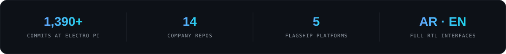
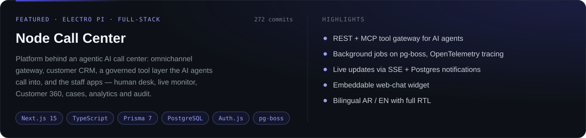
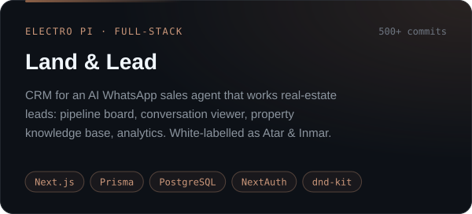
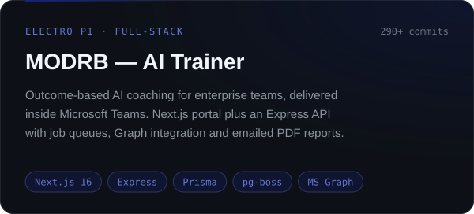
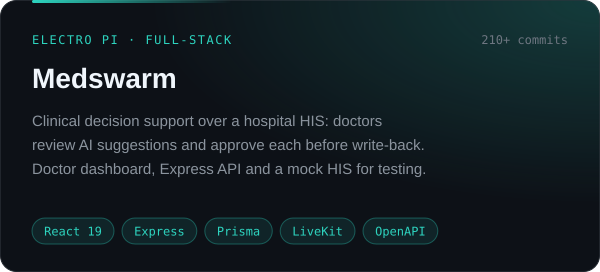
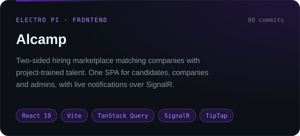
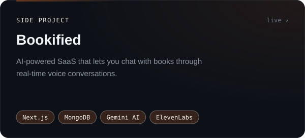
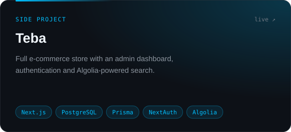

<div align="center">



<br/>

<a href="https://www.yousifmamdouh.tech"></a>
<a href="https://www.linkedin.com/in/yousifmhelal/"></a>
<a href="mailto:YousifM.Helal@gmail.com"></a>

</div>

<br/>

## 🧑‍💻 About Me

I'm a **full-stack developer at [Electro Pi](https://github.com/Electro-Pi)**, where I build the web platforms around AI products — the dashboards people work in, the APIs and job queues behind them, and the data models underneath. Most of what I ship is **Next.js + TypeScript** on the front, **Node.js / Express + Prisma + PostgreSQL** on the back, bilingual **Arabic / English with full RTL**, wired into LLM, voice and WhatsApp agents.

```typescript
const yousif = {
  role:      "Full-Stack Developer @ Electro Pi",
  location:  "Qalyubia, Egypt 🇪🇬",
  available: ["Remote", "Onsite", "Hybrid"],
  stack: {
    frontend: ["Next.js", "React", "TypeScript", "Tailwind", "shadcn/ui"],
    backend:  ["Node.js", "Express", "Auth.js", "pg-boss", "OpenAPI"],
    data:     ["PostgreSQL", "Prisma", "Redis", "MongoDB"],
    ai:       ["Claude API", "Gemini", "LiveKit", "MCP"],
  },
  education: [
    "Postgrad Diploma CS — Cairo University (GPA: A-)",
    "BSc MIS — Higher Institute for Specific Studies (GPA: B+)",
    "ITI Frontend Development — React (120hrs)",
    "Harvard CS50 + SOLID Principles",
  ],
  currentlyBuilding: "AI-powered platforms — call centers, CRMs, coaching & clinical tools",
  funFact: "Built enterprise systems during military service — offline, no internet 💪",
};
```



<br/>

## 🚀 Featured Work

<sub>Private client platforms built at Electro Pi. Source is confidential, so these are summaries.</sub>

<table>
<tr>
<td colspan="2"></td>
</tr>
<tr>
<td width="50%"></td>
<td width="50%"></td>
</tr>
<tr>
<td width="50%"></td>
<td width="50%"></td>
</tr>
</table>

## 🛠️ Side Projects

<table>
<tr>
<td width="50%"><a href="https://bookified-bay.vercel.app/"></a></td>
<td width="50%"><a href="https://teba-ecommerce-theta.vercel.app/"></a></td>
</tr>
</table>

## ⚡ Tech Stack

<div align="center">


<br/>

<br/>

<br/>


</div>

## 📊 GitHub Activity

<div align="center">


</div>

<br/>

<div align="center">
<sub>Open to freelance, full-time and interesting collaborations — <a href="mailto:YousifM.Helal@gmail.com">let's build something</a>.</sub>
</div>
